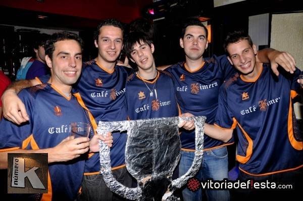
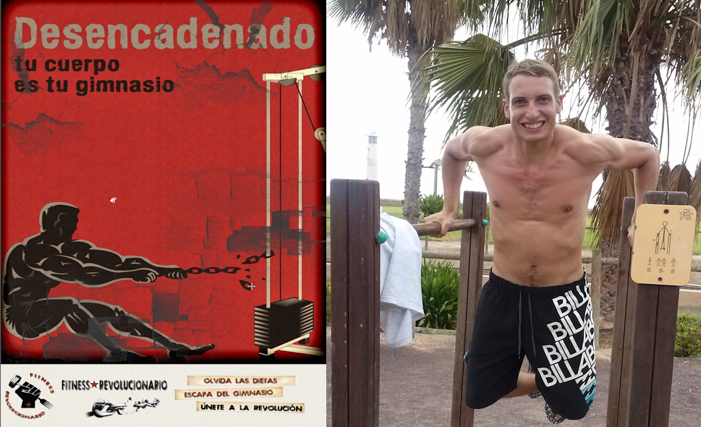
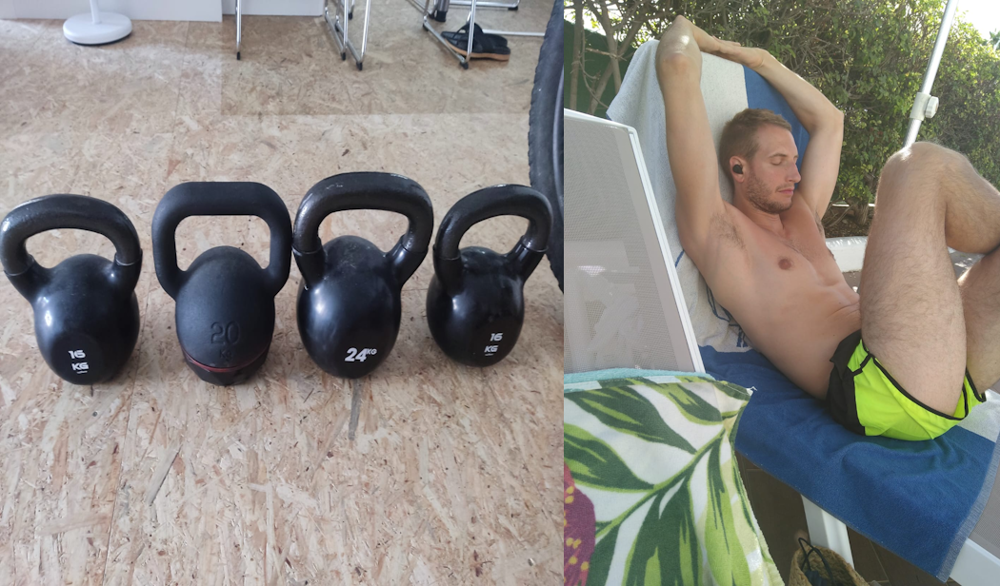
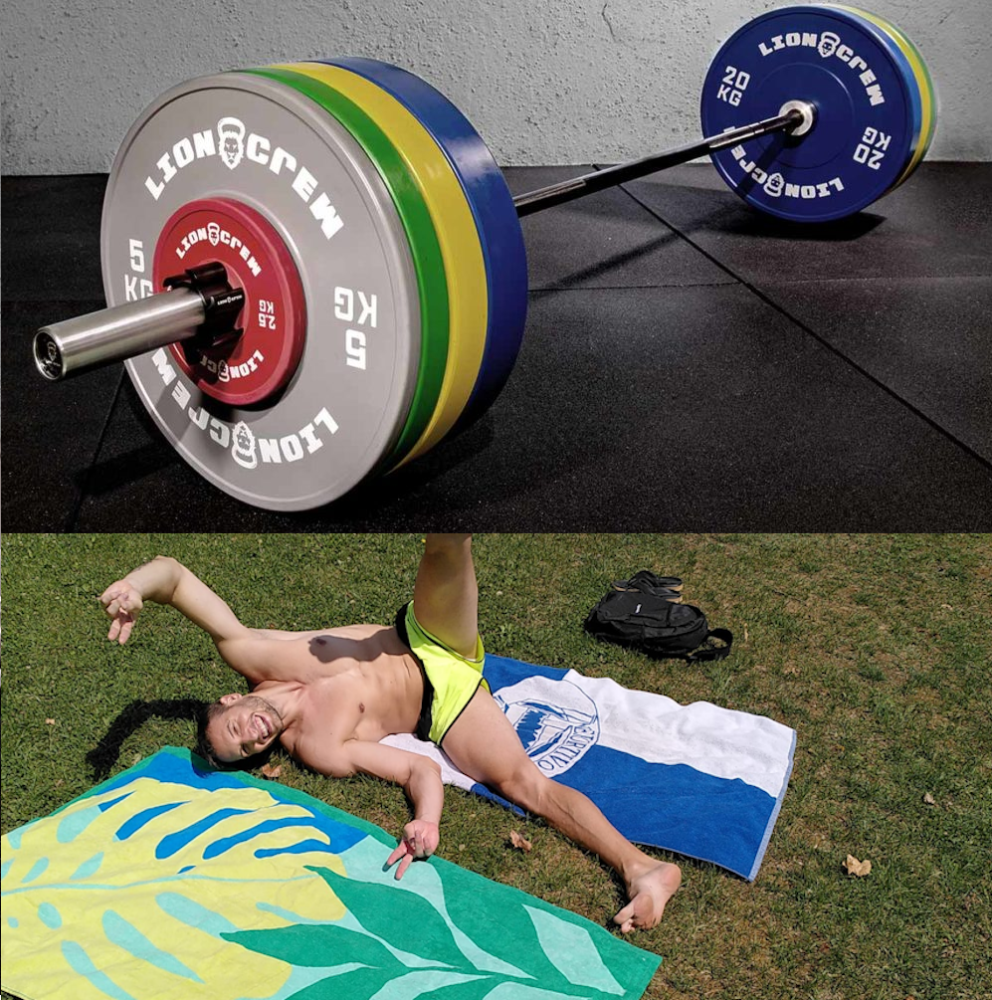
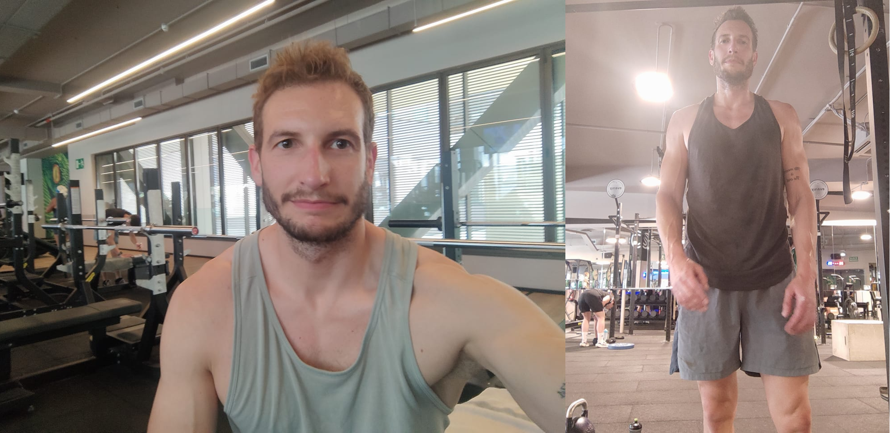

Antes de nada, quiero dejar claro que esto no pretende ser una guía universal para todo el mundo. Aunque es cierto que genéticamente somos muy parecidos, las pequeñas diferencias, sumadas a nuestra experiencia vital, dan lugar a expresiones muy diferentes cualitativamente hablando. De ahí la importancia de conocerse a uno mismo, ser honesto, y trazar tu propio camino. Esto aplica para todo, y en el deporte no puede ser menos.

No obstante, dejo aquí plasmado mi camino hasta el momento actual, por si alguien se ve identificado en alguna de las etapas intermedias, y le resuena alguna de las etapas siguientes, o incluso anteriores, para ponerla en práctica.

## Y al principio fue… El fútbol-sala

En realidad el primer deporte que practiqué de forma estructurada fue el judo, pero pasaré esa parte por no ser tan relevante para este post. Enseguida me vi arrastrado por la masa social, y me apunté al equipo de fútbol-sala del colegio. Desde entonces, varios años de deporte escolar y más tarde la formación del club deportivo Las Antillas, al que le debo tantos **buenos momentos y** tantas **amistades** (algunas de ellas muy muy buenas).

Sin embargo, seguramente por problemas de falta de fuerza y equilibro estructural, comencé a sufrir **lesiones diversas** como condromalacia rotuliana, tendinitis en el aquiles, ampollas en los pies… Paré un año, volví sin haber solucionado nada, probé otro año fútbol 7, y al final dejé este bonito deporte no sin sentir bastante frustración por ello.

## La calistenia: De la incredulidad, al asombro

Fue en esas cuando el año después de dejar el fútbol, y alternando el running con pesas en casa, le pregunté en una cena de empresa a mi *compi* [Héctor](https://www.tuentrenadorenvitoria.es/sobre-mi/) que qué era lo que él hacía para tener un cuerpo tan trabajado. Héctor, que es un personaje pero también una gran persona, me dijo que él hacía ejercicio en casa y "Te voy a decir dos palabras: **Fitness Revolucionario**. Busca en Google". No os podéis imaginar lo que en aquella época significaba que un tío *cuadrado* te dijera que entrenaba en casa sin equipamiento. Incredulidad total. No, no había influencers ni nada de eso. En mi cabeza, cualquiera que estuviera *superfit* vivía en el gimnasio y levantaba hierro a destajo.

No obstante, busqué lo que me dijo y encontré un blog de un tío con un conocimiento brutal, un *coco*. Además de los artículos, el autor, Marcos, tenía un programa en PDF para hacer ejercicio en casa: **Desencadenado**. El resto ya es historia: algunos de los compañeros de trabajo nos compramos el programa y empezamos a ponerlo en práctica. Para mí era como un mundo nuevo en el que todo encajaba. Antes de leer el programa, no sabía que era una sentadilla o una dominada. Pero podía sentir como mejoraba mi fuerza, mi potencia, mi movilidad… La motivación iba en aumento cada semana.

Me lo tomé en serio, como cada vez que encuentro algo nuevo que me encaja, y en el siguiente verano… Las sorpresas de la gente al verte sin camiseta. Mucho ego ahí, lo que quieras, pero era la constatación de que algo se estaba haciendo bien. Me vi mis primeros *cuadraditos* a los 27 años aproximadamente. Estaba flipando.

Seguí haciendo varias rondas de Desencadenado. Notando mejoras, disfrutando… Hasta que, como siempre, te empiezas a aburrir de hacer siempre lo mismo.

## Kettlebells: Peso libre para dar un paso más allá

Para entonces, Marcos ya había sacado un nuevo programa: **Efecto Kettlebell**. Lo tenía comprado desde hacía un tiempo, leído… Faltaba darle calor. Pero la verdad es que me daba pereza empezar algo nuevo e incluso sentía cierta resistencia. Desencadenado me funcionaba, era lo conocido…

Aún así comencé Efecto Kettlebell en medio de una situación personal complicada. Hice 2 rondas… Y no las disfruté. Me costaba mucho adaptarme al nuevo paradigma: muchos ejercicios *full body*, de potencia, de resistencia… Ya me había acostumbrado a dividir las sesiones por tipos de ejercicios, a llegar al fallo, a notar los músculos que quería trabajar… No me acostumbré a ese cambio.

## Barra olímpica: A por el bingo

Para entonces, de nuevo, Marcos ya había sacado otro programa: **Barra Libre**. Cuando me lo leí, el enfoque me pareció más parecido al de Desencadenado en muchos aspectos que eran importantes para mí, así que decidí probarlo e intentar sacarme el mal sabor de boca de mi experiencia con Efecto Kettlebell.

Seguía en la misma situación emocional complicada, y con Barra Libre me fue más o menos igual de mal. En este caso lo que más me crujía era hacer tanto descanso entre rondas, tan pocas repeticiones, un progreso de cargas que no conseguía seguir si no era *trampeando* la técnica del ejercicio… De nuevo, frustración.

Fue en esas que me apunté a un box de **Crossfit**. Sentí que me faltaba ese componente de socialización y de salir de la zona de comfort, así que me pareció que era un deporte que podía encajar con lo que necesitaba en ese momento. Estuve alrededor de año y medio asistiendo a 2 clases de Crossfit semanales y haciendo otros días "a mi bola" alternando ejercicios de calistenia, kettlebells y barra olímpica. Básicamente escogí aquellos que más me gustaban de cada programa y los que creía que podían venirme bien para progresar o al menos no perder capacidades físicas.

Mi situación emocional mejoró algo pero tampoco significativamente. No encajé con la cultura del box, ni con el enfoque del Crossfit, así que lo terminé dejando también.

## De Barra Libre…. a Free Style

Fue entonces cuando volví a hacer deporte por mi cuenta. Y lo que hice fue crearme programas semanales con los ejercicios que creía que eran más eficaces y con un nivel de carga exigente. Me apunte al gimnasio y me "obligué" a asistir a una clase programada semanal, para mantener el rollo social.

Mi objetivo era poner en práctica todo el conocimiento que había recogido durante todos estos años y también salir del cascarón de una forma que me resultara cómoda.

Así me fue bien un tiempo hasta que me aburrí… Y me estanqué. No conseguía progresar, y cada vez me sentía más cansado. En esas conocí a uno de los tíos más mazados del gimnasio que tenía 55 *añazos* y no se metía ninguna mierda (más allá de proteína de suero). Yo por entonces entrenaba fuerza 4 días por semana y otro día hacía una sesión de HIIT (alta intensidad). Él estaba empeñado en que entrenar más de 3 días a la semana era perder el tiempo e incluso contraproducente.

Así que cambié mi propio programa, para hacer sólo 3 días de fuerza y uno de HIIT y… ¡Ganar un día libre! Esto puede parecer una chorrada, pero para una de las tantas mentes rígidas que pululamos por el gimnasio no es *peccata minuta*. Así lo hice por un tiempo y con buen resultado el tema del descanso. Txema tenía razón, le estaba metiendo demasiada caña. Luego me aburrí, volví a hacer otra ronda de Desencadenado, otra de Efecto Kettlebell (esta vez disfrutándola muchísimo), y otra de Barra Libre (a medias). Tanto Desencadenado como Efecto Kettlebell comportan sesiones de 4 días a la semana pero son programas menos exigentes y con sesiones cortas. Pero la segunda parte de Barra Libre (Hipertrofia) implicaba volver a los 4 días de entrenamiento de fuerza… Y sinceramente, me dio pereza. Ni quería perder un día "libre", ni quería volver a despertar al monstruo.

En ese momento, como casi siempre en esta historia, ya me había comprado y leído otro programa. En este caso era **Anti-TRT, de [Anticulturista](https://www.anticulturista.com/)**. Un chaval que había empezado a seguir hacía unos meses porque lo recomendaba un experto en IA (sí, cosas de la vida 😅).

## Current Stage: Equilibrio estructural

A Pedro, la persona detrás de Anticulturista, hacía tiempo que le había *comprado el libro*, en el sentido de que me encaja muchas de las cosas que dice: equilibro estructural, prevención de lesiones, carga que permita hacer más cosas que entrenar fuerza en el gimnasio… Un nuevo paradigma, un nuevo juguete 🙂.

Y con eso estoy ahora mismo, comenzando el programa de Anti-TRT con muy buenas sensaciones, disfrutando de su división en días de excéntrico, isométrico y concéntrico, volviendo a dar un poco la nota en el gimnasio, y volviendo a las sesiones semanales de sprints después de tantos años. Recuperando la rodilla poco a poco, fortaleciendo espalda baja e isquiotibiales, trabajando pequeños grupos musculares olvidados… Encantado, al menos de momento. Incluso me permite hacer otros deportes como padel o salir a hacer rutas sin sentir las piernas sobrecargadas desde el primer kilómetro.

<video src="/videos/calistenia-equilibrio-estructural-hang-clean.mp4" controls style="max-width: 100%; height: auto;"></video>

## Conclusión

Lo siento, pero la conclusión es que no hay conclusión 😄. Simplemente añado este apartado final para dejar claro que con este post no quiero decir que éste sea el camino a elegir. Ni siquiera quiero dar a entender que haya habido una evolución natural o algo así. La vida es caótica. Tampoco quiero dar a entender que el equilibro estructural es el santo grial o la panacea. Pero, es cierto que a mí me encaja y me está gustando. Trabajar el equilibrio estructural manteniendo la parte central de entrenamiento funcional para mí es como poner la guinda al pastel. Pero aparecerá un nuevo libro… Lo sabes tú, lo sé yo y lo sabe mi prima la del pueblo.

Puede que tú hayas probado alguna de estas cosas y estés estancado, aburrido o frustrado. Si es así, espero que te ayude a probar otra cosa y seguir adelante. Si no, pues deseo que hayas aprendido algo nuevo o al menos te hayas entretenido 😉.
