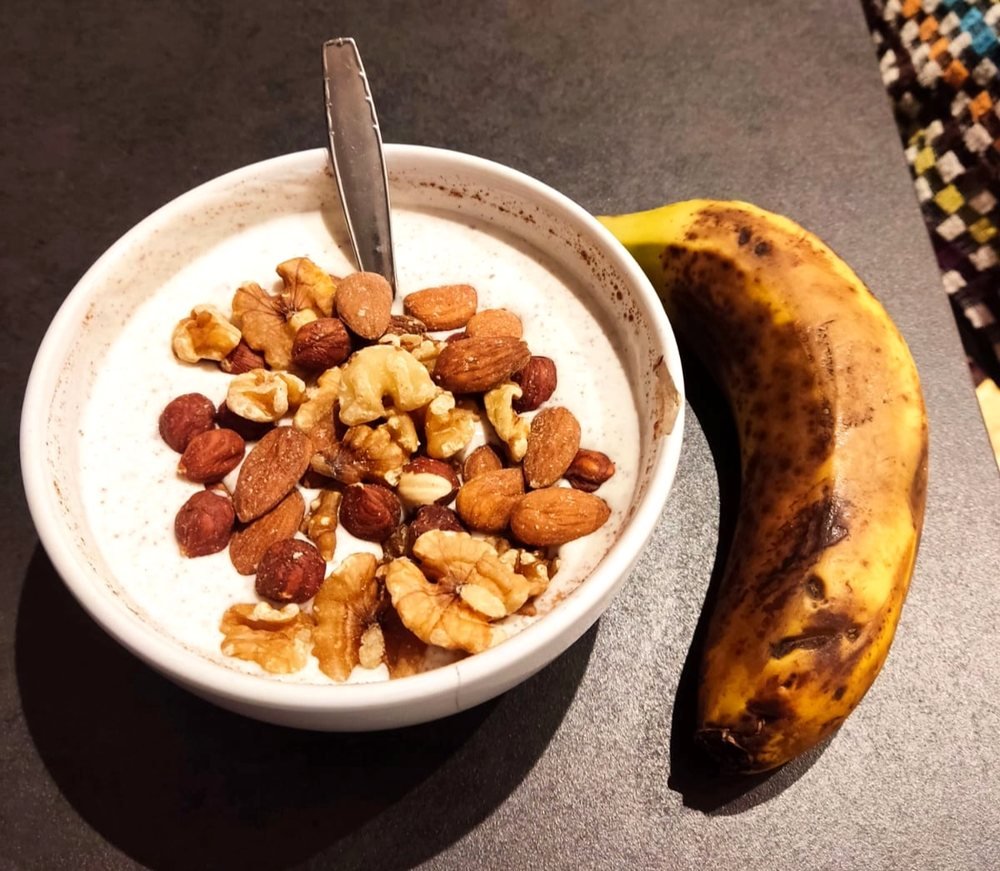
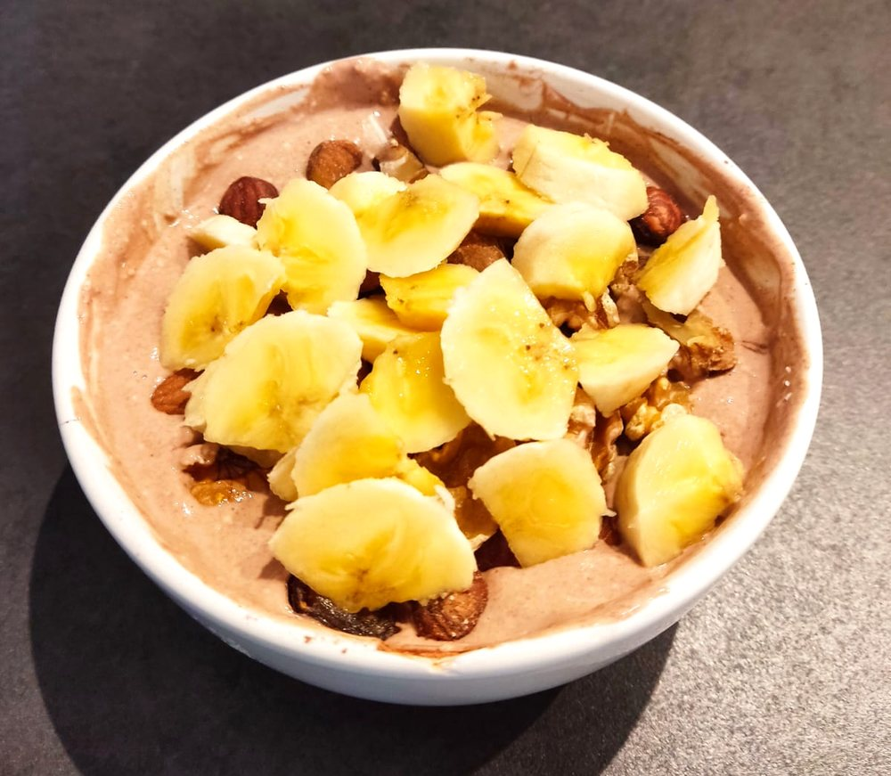
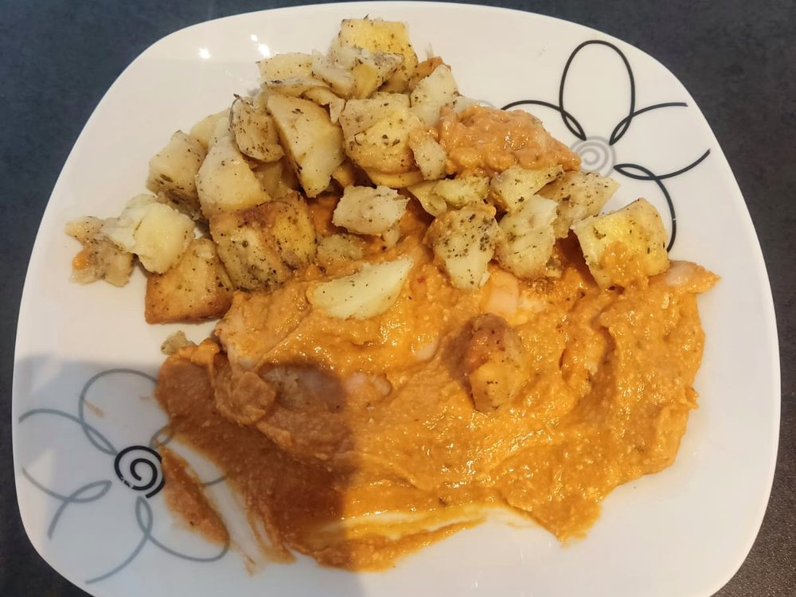
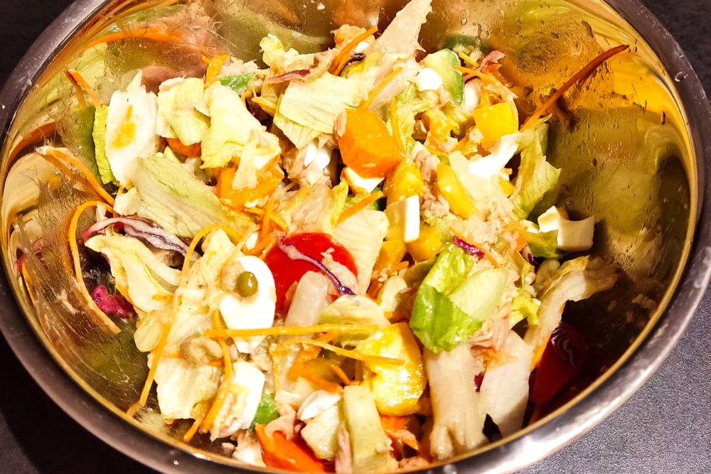

Soy consciente de que gran parte de la dificultad que mucha gente experimenta para comer sano reside en un aspecto psicológico muy por encima de la falta de conocimiento o tiempo. Aunque muchas personas utilicen sobre todo este último punto como excusa. La mayoría, sin embargo, creo que es consciente de que se deja llevar en el tema de alimentación, simplemente porque no es su prioridad en ese momento, y no pasa nada. Ocurre algo parecido con el deporte, la formación, la socialización… y un largo etcétera.

No es mi objetivo modificar el enfoque psicológico de nadie, al menos de forma directa, porque sé por experiencia que no sirve de nada. Cada uno tenemos nuestros genes, historia, etc., y la psicología se asienta sobre todo eso. No se puede cambiar algo así de un plumazo.

Peroooo hay veces que uno se encuentra en un momento de hacer un cambio importante, o que está más receptivo a un cambio en ese aspecto, y es ahí donde un artículo de este tipo puede hacer un “clack” dentro de la cabeza de alguien, para que comience un cambio de hábitos positivo.

## La búsqueda obsesiva de equilibrio

[MODO HUMILDAD OFF] Unas cuantas personas me han preguntado últimamente que qué hago para parecer más joven (también es cierto que aquellas personas que te ven más mayor no te suelen decir nada 😄). Habrá factores genéticos de tipo físico, no digo que no, pero creo que los más importantes son los factores psicológicos (vengan estos de los genes o el ambiente, a saber) [MODO NORMAL ON]. El caso es que desde bastante joven siempre le he dado mucha importancia al equilibrio. Y no sólo en un aspecto de la vida, sino en todos. Y no sólo en mí, sino en la realidad que me rodea (y de la que formo parte) también.

Hay básicamente **dos formas de intentar encontrar un equilibrio**:

- **Intentar estar siempre “en el medio”**: Hacer deporte a intensidad media 5 días a la semana, beber una copita de vino a diario y no más, comer más o menos sano en desayuno, comida y cena, quedar con amigos 2/3 veces por semana, etc.
- **Alternar extremos**: Básicamente lo que [Homer hacía cuando consumía sustancias estimulantes y ansiolíticas al mismo tiempo](https://www.youtube.com/watch?v=gmO9smmHOZE). Comer de forma super estricta entre semana y atiborrarte a comida basura el fin de semana, no beber ni gota de alcohol de lunes a jueves y dar rienda suelta al borrachillo que llevas dentro el viernes y sábado, hacer sesión de sprints a la mañana y tarde de sofá y manta…

Estas formas de actuar no son precisas y estancas, y ambas opciones tienen ciertas variaciones, pero en general lo que mejor creo que funciona (y lo que hace la vida más divertida) es alternar ambas.

## Haz que lo difícil sea fácil

Esto es más viejo que el hambre (gran frase para este artículo) pero la clave para lograr el equilibrio es ponértelo fácil para lograr hacer esas cosas “buenas” que compensan las otras no tan buenas que te resultan muy fáciles de hacer. Y yendo a la comida, esto no tiene mucha dificultad. Básicamente consiste en organizar parte de tu vida (una parte pequeña, como podrás comprobar), para que comer sano, variado y nutritivo te resulte muy fácil (y, espero, gratificante).

Basta de teorizar y vayamos al grano. Te voy a mostrar mis trucos para conseguir llevar los nutrientes necesarios a mi cuerpo *every week* casi sin esfuerzo logístico e ingiriendo comida sana sin mierdas (a no ser que me apetezca comerlas porque sí).

## Desayuno

Tengo dos desayunos estándar muy parecidos pero algo diferentes dependiendo de la situación:

- Dispongo de **suficiente tiempo**: Base de yogur/queso batido/kéfir, añadiendo miel, canela, cacao en polvo, coco rallado, dátiles, frutos secos y una fruta (normalmente plátano). Lo único que no puede faltar es el primer ingrediente. El resto, si falta, no supone ningún drama y muchas veces puede ser reemplazado por otro: miel por otro edulcorante (o nada), cacao por té matcha o café (o descafeinado) en polvo, dátiles por pasas, frutos secos por semillas, alternar la fruta…
- Voy **a la carrera**: yogur o kéfir, miel y frutos secos. Me llevo una pieza de fruta para la ofi o el camino. Listo.
- Me canso y **quiero variar**: Revuelto con queso y atún o jamón de york.
- Estoy fuera por trabajo o vacaciones: Intento buscar un sitio donde no sea todo pan y bollería, pero, ¡qué coj\*\*\*\*! Llevo todo el año desayunando sano. ¡Me lo puedo permitir!

 

Desayuno “express”Desayuno “pro”

## Comida

Este apartado va a ser muy corto. No va de recetas, sino de trucos mucho más sencillos.

- **[Wetaca](https://wetaca.com/)**: Mis platos principales de las comidas entre semana me los provee esta empresa. Son platos muy parecidos a los que yo haría si tuviera tiempo y ganas. Comida real y variada. Más que suficiente. Si tu empresa tiene ticket restaurante, puedes descontártelo del IRPF.
- Huevos cocidos, humus, salmorejo, tortilla de patata: A veces el plato del Wetaca se me queda corto, por lo que al terminar suelo comerme un huevo cocido con un poco de jamón o atún, o alguna cosa comprada en el super que no lleve azúcar añadido.
- De postre, fruta: Innegociable.

Ejemplo de comida de Wetaca: Solomillo con patatas rústicas

Confesión: En casa tengo “el rincón de los dulces” o “el rincón del vicio”. Puedo estar una semana sin mirar ese lugar del pecado de mi cocina y de repente dar con todo en un par de días. Puede ser por entrenar mucho, estar malo, ansiedad…

El finde suelo ir un día a comer fuera y otro donde mis padres, pero si no es el caso, un bote de legumbres con un sofrito y unos filetes de pollo/pavo a la plancha hacen su función de forma sobresaliente, por poner un ejemplo de comida sencilla y sana.

## Cena

Aquí sigo la jerarquía de plato estándar, alternativas típicas, y alternativas de las alternativas.

- **Ensalada**: Con este plato me pasa como con el desayuno a base de yogur y más cosas. Es un plato muy versátil y puedes comer muchos tipos de ensalada con ingredientes muy diferentes. De hoja verde puedes usar lechuga (de varios tipos), rúcula, canónigos, espinacas… Pero es que luego puedes echarle pepino, cebolla, pimientos, zanahoria, huevo cocido, queso (de muchos tipos), latas de conserva (de diferentes pescados/mariscos), espárragos, quinoa, arroz, garbanzos cocidos, patata cocida, boniato, aguacate, tomate (de varios tipos). Sin duda para mí el plato estrella de cualquier tipo de comida. Si no inviertes mucho tiempo en la zona de vegetales del super, es que no estás sacando provecho de este plato tan mágico.
- Platos **alternativos**: No sólo de pan vive el hombre, y a veces uno se cansa de la ensalada, por muy versátil que sea. En esos días suelo tirar por platos muy sencillos como salmón con brócoli, carne picada con champiñones, o filetes de pollo/pavo con boniato, humus, tortilla de patata (sí, sí, del super). Cero complicación. Air fryer, unas especias y a correr.
- La **alternativa de la alternativa**: Si ya me canso también de las alternativas, me hago un revuelto con un sofrito, queso y alguna proteína (atún, jamón ibérico, tacos de pollo) y como Dios.

Ensalada “con todo”

Cuando estoy de viaje intento tirar mucho de pokes también. Es una muy buena alternativa a las cenas guarras típicas de cuando estás fuera de casa. Y si no es posible… ¡No pasa nada! Te lo has currado el resto del año.

## Disclaimer

No. No sólo como eso. También salgo por ahí, de vez en cuando bebo algo, como alguna mierda, y hasta tengo días sedentarios. Sinceramente, no como mierdas porque me apetezcan. Por ejemplo, los típicos pintxos, con mil de pan, aceite y sal, me dan bastante para atrás, pero priorizo socializar (y, desde luego, no dar la tabarra a nadie con mis hábitos ni ir de *iluminati* por la vida). Lo único que sí que suelo hacer por mi cuenta y riesgo es pillar de vez en cuando dulces del rincón del pecado de la cocina.

Y eso es todo. Creo que este artículo puede servir más para saciar la curiosidad de algunas mentes inquietas que otra cosa, pero, si a alguien le ayuda a comer más sano, bienvenido sea.

Comentar por último que mi referente actual para temas de nutrición es Javier Angulo, que tiene un [Instagram](https://www.instagram.com/javierangulofer/?hl=es) muy entretenido y él sí sabe cómo motivar a la gente para comer sano, rico y con alegría.

Al final se trata de llenar el buche con alimentos sanos para dejar el mínimo hueco posible a aquellos alimentos que no sólo no son nutritivos sino que dañan tu metabolismo y salud general.
