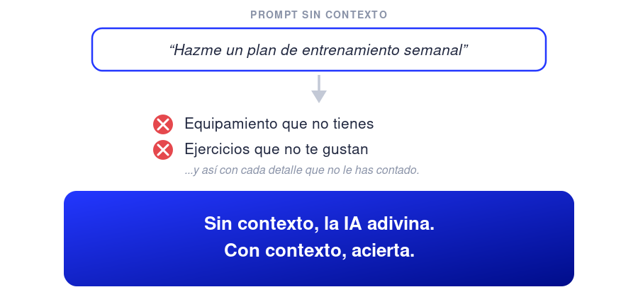
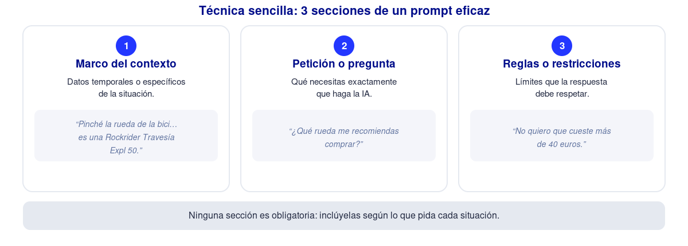

Queremos la pastilla mágica: pulsar un botón, hacer click o deslizar la pantalla… Ya nos da pereza hasta llamar. Y me incluyo. Somos seres perezosos, buscamos la vía rápida. Actuamos o consumimos mucho más de lo que pensamos… No, nada de esto es malo per sé. Es parte de nuestra biología, y ésta nos ha llevado hasta donde estamos ahora, que no está nada mal. De hecho, no es que seamos perezosos: **somos seres eficientes y eficaces**, orientados a la supervivencia, la reproducción y el cuidado, no a la búsqueda de la verdad. Visto así no tiene tan mala pinta, ¿no? 🙂.

¿Qué tiene que ver esto con el título del post? Pues mucho, porque veo que muchas personas no hacen un uso óptimo de la IA, o no le sacan el rendimiento que podrían, por **dejarse llevar demasiado por el impulso de la pereza o el mínimo esfuerzo**. Y lo sé de primera mano, ya que al principio sobre todo yo caía en el mismo error y todavía sigo cayendo de vez en cuando.

## La IA sin contexto pierde casi todo su valor

Típica situación (un poco exagerada probablemente): Quiero ponerme a hacer deporte. Le pido a la IA (ChatGPT, Gemini o la que sea) que haga un programa semanal de entrenamiento. Me suelta uno. Me pongo a mirarlo y… No me cuadra para nada. Incluye ejercicios con equipamiento que no tengo. Sesiones más largas de lo que me puedo permitir. Ejercicios que desconozco. Otros ejercicios que no me gustan. Más cardio que fuerza cuando quiero enfocarme en lo primero… Etc, etc.

Y claro, **la conclusión es fácil: la IA es una mierda**, no es tanto como la pintan, se equivoca mucho, no razona…. Que sí. Lo que quieras. Pero nosotros también tenemos una responsabilidad. Y, por mucho que las empresas de IA sigan mejorando los modelos y las herramientas que nos ofrecen, siguen necesitando de su recurso más preciado: **contexto**. Sin contexto, en muchas ocasiones, no son nada.

## Excepciones

¿Existen excepciones? Sí, las hay. Ejemplos muy típicos para mí son ciertas compras sencillas, recetas de cocina o dudas técnicas simples.

Prompts muy típicos en mi caso son: "¿Cómo hago muslos de pollo en el air fryer?", "Recomiéndame un aspirador de mano barato pero de calidad aceptable", "¿Cómo habilito SQL Server Express para que pueda ser accedido de forma remota?". **Da igual quién haga esto, el objetivo está claramente implícito en la petición o pregunta y son ejemplos tan básicos que básicamente no aplica ninguna o casi ninguna regla.**

Como siempre, hemos de encontrar un buen equilibrio, y es justo aclarar que no siempre tenemos que rompernos los cuernos antes de interactuar con estos *bichos*.

## Trucos básicos

En [este post](/blog/uso-ia-nivel-personal/) ya hablé sobre contextos más estructurales y generales como los **Custom Instructions, el More About You o los proyectos** en ChatGPT (y aplicable a otras herramientas similares como Claude o Gemini). Son trucos básicos, que realizas una sola vez (y actualizas de vez en cuando, cuando toca) y te dan un beneficio brutal.

## Técnica sencilla para dar el contexto ideal a ChatGPT, Claude, Gemini o Grok

Una vez tenemos cubiertos los básicos, dar el contexto adicional necesario a la IA se vuelve más simple y sencillo. Pero para hacerlo todavía más automáticamente, te propongo una técnica concreta. Se trata de **dividir el prompt en 3 secciones diferentes**. Esto puede sonar un poco abrumador o dar pereza, pero ahora verás que apenas supone un pequeño esfuerzo adicional con respecto a lo que probablemente estabas haciendo hasta ahora.

**Un prompt eficaz y eficiente se compone de:**

- **Marco del contexto:** El contexto del contexto. Aquí es dónde le das a la IA el contexto general que necesita para poder cumplir con tu petición. Por ejemplo, si he salido de fiesta y he dormido sólo 4 horas y quiero preguntarle a la IA si es buena idea mantener el entrenamiento que tenía pensado hacer, pues le doy ese contexto antes de lanzar la pregunta en lugar de simplemente decirle que estoy cansado o simplemente preguntarle si me puedo saltar el entrenamiento sin darle más datos. Sé honesto y preciso. No hace falta nada más. Además, si has hecho el *setup* de tu IA cómo expliqué en [este post](/blog/uso-ia-nivel-personal/), aquí simplemente tendrás que añadir información temporal ("tengo gripe", "se me ha pinchado la rueda de la bici", etc.) o muy específica de la pregunta/petición a realizar ("tengo una tienda de Ikea a 50 metros", "mi casa tiene sólo plato de ducha", etc.).
- **Petición o pregunta:** Ésta es la parte que no nos solemos saltar, aunque con algunos matices. A veces simplemente le decimos algo como "no se enciende el móvil" o "mis vecinos de arriba no paran de gritar". En casos como estos, seguramente tampoco hace falta añadir la pregunta o petición de manera explícita. Pero tampoco te vengas arriba, evalúa bien si es necesario incluirla o no porque muchos prompts se benefician de una petición/consulta bien planteada cómo "transforma este pdf en una ppt dirigida a una formación de técnicos de laboratorio" o "¿qué tipo de sal es la que mejor va a este plato?".
- **Reglas o restricciones** a cumplir: De nuevo, si has seguido las pautas del post del *setup* te vas a librar de tener que escribir esta parte muchas veces pero, aún así, tal y como ocurre con la sección de "Marco del contexto", habrá veces que sea muy beneficioso añadir esta parte también. Aquí añadimos reglas o restricciones que queremos que la IA cumpla a la hora de realizar su tarea cómo "no quiero que el precio pase de 200 euros", "que el alojamiento no esté más lejos de 3 km del centro" o "que sea rojo". En principio no es necesario añadir algo como "porque es el color del coche que tenía mi padre cuando nos llevaba de viaje a Benidorm, me trae buenos recuerdos y además me gusta el tomate". Sólo cosas relevantes para la tarea.

## Ejemplo

Un ejemplo de post "completo" puede ser éste:

*El otro día pinché la rueda de la bici cuando volvía del gimnasio a casa. Hay varias obras cerca de mi casa y he visto varios clavos por el suelo y las carreteras estos días. Podría ser por esto. Las ruedas que tenía son las que venían con la bici. La bici es una Rockrider Travesía Expl 50.*

*¿Qué rueda me recomiendas comprar?*

*No quiero que cueste más de 40 euros.*

Lo he divido en párrafos para que quede más claro qué es el marco, la pregunta y la restricción, pero tampoco es estrictamente necesario que elijas este formato y este orden.

Ninguna de las 3 secciones es obligatoria en todos los casos. Incluir o no el marco y las restricciones dependerá mucho de la petición/consulta a realizar, pero es que incluso la propia pregunta o petición puede ir implícita en el marco, por ejemplo, y estos *bichos* suelen ser lo suficientemente listos para entenderlo.

Parte de esta técnica se me ha ocurrido a mí a base de prueba y error, pero sin duda fue Alex Banks y [su newsletter](https://thesignal.substack.com/) los que me ayudaron a ponerla de manera estructurada, ya que al parecer él también había llegado a una conclusión muy similar. Si quieres estar al día sobre IA, dar un paso más allá y no te importa leer en inglés, sin duda es una *newsletter* muy recomendable.
